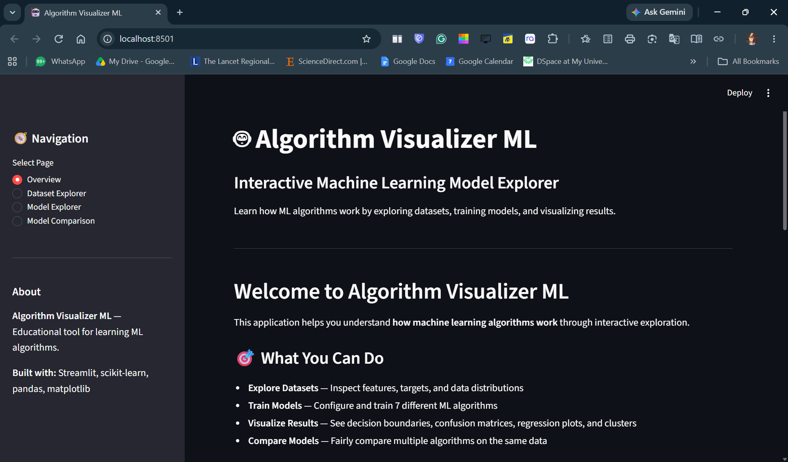
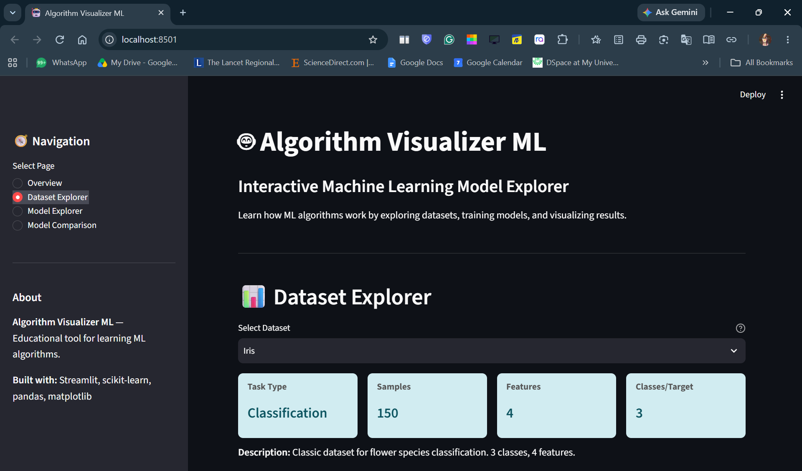
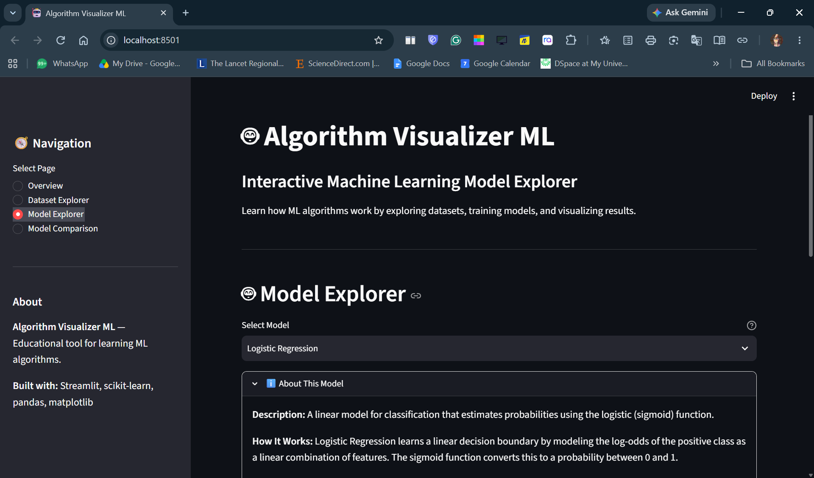
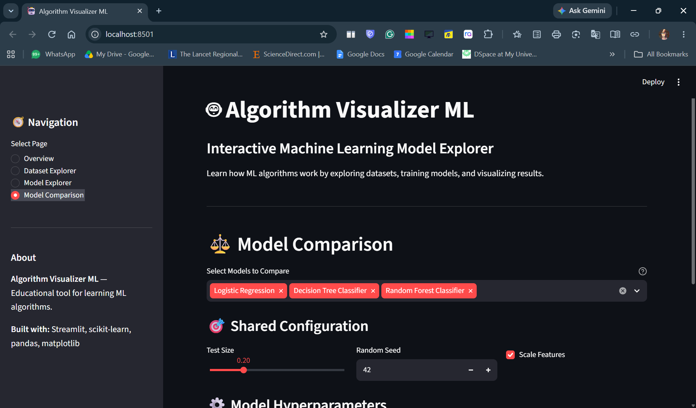

# Algorithm Visualizer ML 🤖

**An interactive web application for learning and exploring machine learning algorithms through hands-on visualization.**

Understanding how ML algorithms work requires more than reading equations — it requires seeing them in action. Algorithm Visualizer ML bridges the gap between theory and intuition by letting students explore datasets, configure algorithms, train models, and inspect results through an interactive Streamlit interface.

Built for university coursework, self-study, and technical demonstrations.

---

## Table of Contents

- [Features](#features)
- [Supported Algorithms](#supported-algorithms)
- [Supported Datasets](#supported-datasets)
- [Evaluation Metrics](#evaluation-metrics)
- [Technology Stack](#technology-stack)
- [Architecture](#architecture)
- [Installation](#installation)
- [Running the Application](#running-the-application)
- [Running Tests](#running-tests)
- [Example Workflows](#example-workflows)
- [Limitations](#limitations)
- [Screenshots](#screenshots)
- [Project Team](#project-team)
- [License](#license)
- [Attribution](#attribution)

---

## Features

| Feature | Description |
|---------|-------------|
| **Dataset Explorer** | Browse 5 built-in datasets; inspect feature distributions, correlations, target balance, and summary statistics |
| **Model Explorer** | Configure hyperparameters, train any of 7 algorithms, and view metrics + visualizations in real time |
| **Rich Visualizations** | Decision boundaries, confusion matrices, regression lines, residual plots, cluster scatter plots, silhouette analysis |
| **Model Comparison** | Select 2+ compatible algorithms; fair comparison on identical train/test splits with metric tables, bar charts, and radar plots |
| **Educational Explanations** | Every algorithm page includes: what it does, how it works, when to use it, and its limitations |

---

## Supported Algorithms

### Classification (predicting categories)

| Algorithm | Key Idea |
|-----------|----------|
| **Logistic Regression** | Linear decision boundary with probability estimates via sigmoid |
| **Decision Tree Classifier** | Recursive feature-space partitioning using Gini/entropy |
| **Random Forest Classifier** | Ensemble of decorrelated trees with majority voting |
| **K-Nearest Neighbors** | Instance-based classification via majority vote of k neighbors |
| **Support Vector Machine** | Maximum-margin hyperplane (linear & RBF kernels; probability via Platt scaling) |

### Regression (predicting continuous values)

| Algorithm | Key Idea |
|-----------|----------|
| **Linear Regression** | Ordinary least squares; models y = β₀ + β₁x₁ + … + βₙxₙ + ε |

### Clustering (unsupervised grouping)

| Algorithm | Key Idea |
|-----------|----------|
| **K-Means Clustering** | Iterative centroid-based partitioning minimizing within-cluster inertia |

---

## Supported Datasets

| Dataset | Task | Samples | Features | Description |
|---------|------|---------|----------|-------------|
| **Iris** | Classification | 150 | 4 | Classic flower species (setosa, versicolor, virginica) |
| **Breast Cancer Wisconsin** | Classification | 569 | 30 | Binary diagnosis (malignant / benign) |
| **Diabetes** | Regression | 442 | 10 | Disease progression after one year |
| **Synthetic Regression** | Regression | 200 | 5 | Generated data with controllable noise |
| **Synthetic Blobs** | Clustering | 300 | 2 | Generated isotropic Gaussian clusters (4 centers) |

All datasets load from scikit-learn — no external downloads required.

---

## Evaluation Metrics

### Classification
- **Accuracy** — overall correct predictions
- **Precision (weighted)** — per-class precision averaged by support
- **Recall (weighted)** — per-class recall averaged by support
- **F1-Score (weighted)** — harmonic mean of precision and recall
- **Confusion Matrix** — per-class prediction breakdown with class labels

### Regression
- **MAE** — Mean Absolute Error
- **RMSE** — Root Mean Squared Error
- **R²** — Coefficient of determination (can be negative if fit is worse than horizontal line)

### Clustering
- **Inertia** — Within-cluster sum of squared distances to centroids
- **Silhouette Score** — Mean silhouette coefficient (−1 to +1). The primary metric is computed on the full feature space; a separate 2D silhouette is computed for the silhouette visualization using the same two features shown in the cluster plot.

---

## Technology Stack

| Component | Version |
|-----------|---------|
| Python | 3.10+ |
| Streamlit | 1.35+ |
| scikit-learn | 1.4+ |
| pandas | 2.1+ |
| NumPy | 1.26+ |
| Matplotlib | 3.8+ |
| pytest | 8.0+ |

---

## Architecture

```
algorithm-visualizer-ml/
├── app.py                    # Streamlit entry point
├── requirements.txt          # Dependencies
├── .gitignore
├── README.md
├── LICENSE
├── ml_visualizer/           # Core ML modules
│   ├── __init__.py
│   ├── datasets.py          # Dataset loading & metadata
│   ├── preprocessing.py     # Leakage-safe train/test split & scaling
│   ├── model_registry.py    # Model definitions, hyperparameters, capabilities
│   ├── training.py          # Training, prediction, feature importance, decision boundaries
│   ├── metrics.py           # Classification, regression, clustering metrics
│   └── visualizations.py    # Matplotlib chart utilities for Streamlit
├── ui/                      # Streamlit UI components
│   ├── __init__.py
│   ├── components.py        # Page renderers (Overview, Dataset Explorer, Model Explorer, Model Comparison)
│   └── comparison.py        # Model comparison utilities
├── tests/                   # Unit & integration tests
│   ├── test_datasets.py
│   ├── test_models.py
│   ├── test_metrics.py
│   └── test_app_flow.py
└── docs/
    ├── demo_checklist.md    # 5-minute demo guide
    └── screenshots/         # Placeholder for UI screenshots (currently empty)
```

### Module Responsibilities

| Module | Responsibility |
|--------|----------------|
| `datasets.py` | Loads built-in scikit-learn datasets; provides metadata (task type, feature names, descriptions) |
| `preprocessing.py` | Leakage-safe train/test splitting; feature scaling with DataFrame column preservation |
| `model_registry.py` | Defines all 7 models with hyperparameters, descriptions, capabilities, and default params |
| `training.py` | Model training, prediction, feature importance extraction, decision boundary mesh generation |
| `metrics.py` | Classification (accuracy, precision, recall, F1, confusion matrix), regression (MAE, RMSE, R²), clustering (inertia, silhouette) |
| `visualizations.py` | Matplotlib-based charts for Streamlit display (bar, radar, confusion matrix, etc.) |
| `components.py` | Streamlit page renderers: Overview, Dataset Explorer, Model Explorer, Model Comparison |
| `comparison.py` | Fair model comparison with shared data splits and metric extraction |

---

## Installation

### macOS / Linux

```bash
# Clone the repository
git clone https://github.com/AyanBis/algorithm-visualizer-ml.git
cd algorithm-visualizer-ml

# Create virtual environment
python -m venv .venv
source .venv/bin/activate

# Install dependencies
pip install -r requirements.txt
```

### Windows (PowerShell)

```powershell
# Clone the repository
git clone https://github.com/AyanBis/algorithm-visualizer-ml.git
cd algorithm-visualizer-ml

# Create virtual environment
python -m venv .venv
.venv\Scripts\Activate.ps1

# Install dependencies
pip install -r requirements.txt
```

> **Note:** Python 3.10 or higher is required. The project uses a `requirements.txt` with unpinned versions compatible with the stated minimums.

---

## Running the Application

```bash
# Activate virtual environment (if not already active)
source .venv/bin/activate   # macOS/Linux
.venv\Scripts\Activate.ps1  # Windows

# Launch Streamlit app
streamlit run app.py
```

The application opens at **http://localhost:8501**.

### Navigation

Use the sidebar to switch between four pages:

1. **Overview** — Project introduction and quick-start guide
2. **Dataset Explorer** — Select and inspect a dataset
3. **Model Explorer** — Choose a compatible algorithm, configure hyperparameters, train, and view results
4. **Model Comparison** — Select 2+ models of the same task type for side-by-side evaluation

---

## Running Tests

```bash
# Activate virtual environment first
source .venv/bin/activate   # macOS/Linux
.venv\Scripts\Activate.ps1  # Windows

# Run all tests (64 tests currently)
python -m pytest -q

# Run with coverage
python -m pytest --cov=ml_visualizer --cov=ui
```

**Expected output:** 64 tests pass, compilation clean, no whitespace errors.

---

## Example Workflows

### 1. Classification — Iris with Logistic Regression

1. **Dataset Explorer** → Select **Iris** (Classification, 150 samples, 4 features)
2. **Model Explorer** → Select **Logistic Regression**
3. Adjust **C** (regularization strength) if desired; keep defaults otherwise
4. Click **Train Model**
5. Inspect: Accuracy, Precision, Recall, F1, Confusion Matrix, Decision Boundary (2D slice)

### 2. Regression — Diabetes with Linear Regression

1. **Dataset Explorer** → Select **Diabetes** (Regression, 442 samples, 10 features)
2. **Model Explorer** → Select **Linear Regression**
3. Click **Train Model**
4. Inspect: MAE, RMSE, R², Actual vs Predicted scatter, Residuals vs Predicted, Residual Distribution

### 3. Clustering — Synthetic Blobs with K-Means

1. **Dataset Explorer** → Select **Synthetic Blobs** (Clustering, 300 samples, 2 features)
2. **Model Explorer** → Select **K-Means Clustering**
3. Set **Number of Clusters (k)** (default 3)
4. Click **Train Model**
5. Inspect: Cluster scatter plot with centroids, Silhouette Analysis (2D feature space), Inertia

### 4. Model Comparison — Classification on Iris

1. **Dataset Explorer** → Select **Iris**
2. **Model Comparison** → Select **Logistic Regression**, **Decision Tree**, **Random Forest**
3. Click **Compare Models**
4. Inspect: Metrics table (Accuracy, Precision, Recall, F1), Bar chart, Radar chart

---

## Limitations

- **Educational focus** — Not optimized for production ML pipelines
- **Built-in datasets only** — No custom CSV/data upload
- **No cross-validation** — Single train/test split for simplicity
- **Limited hyperparameter tuning** — Manual configuration only; no grid/random search
- **2D visualizations** — Decision boundaries and cluster plots show only 2 selected features; other features held at training-set means
- **No model persistence** — Trained models not saved between sessions
- **SVM probability calibration** — Uses `CalibratedClassifierCV` (Platt scaling); not native `SVC(probability=True)` due to deprecation

These are intentional design choices for a one-week educational project scope.

---

## Screenshots

The `docs/screenshots/` directory is currently empty.

**To add screenshots later:**

1. Run the application locally: `streamlit run app.py`
2. Capture screenshots of each page (Overview, Dataset Explorer, Model Explorer, Model Comparison)
3. Save as PNG files in `docs/screenshots/` with descriptive names:
   - `overview.png`
   - `dataset-explorer.png`
   - `model-explorer.png`
   - `model-comparison.png`
4. Uncomment and update the markdown below:

```markdown
## Screenshots

| Overview | Dataset Explorer |
|----------|------------------|
|  |  |

| Model Explorer | Model Comparison |
|----------------|------------------|
|  |  |
```

---

## Project Team

- **Ayan Biswas**
- **Anuska Sharma**
- **Ayush Kandhway**

---

## License

This project is licensed under the MIT License — see the [LICENSE](LICENSE) file for details.

---

## Attribution

Inspired by [Algo-Visualizer](https://github.com/Ishwarpatra/Algo-Visualizer) by Ishwar Patra (MIT License, Copyright © 2025 Tanishq Pal).

Built for educational purposes to help students and practitioners understand ML algorithms through interactive visualization.